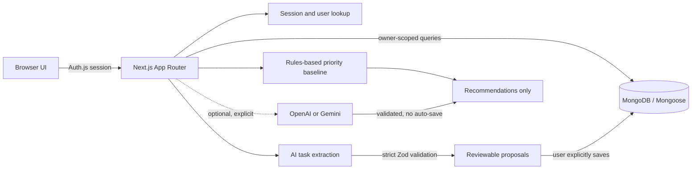

# LifeOS Development Guide

LifeOS is an existing Next.js App Router application using TypeScript, MongoDB/Mongoose, Auth.js credentials authentication, and optional OpenAI or Google Gemini APIs. Route handlers use the Web `Request` and `Response` APIs documented by the installed Next.js version.

## Prerequisites and local setup

- Node.js 20 or newer and npm 10 or newer
- MongoDB local instance or Atlas cluster
- Optional OpenAI or Google Gemini API key for provider-backed recommendations

Install dependencies and create local configuration:

```powershell
npm ci
Copy-Item .env.example .env.local
```

Set local values in `.env.local` (never commit this file). Required application/database settings are:

```env
AUTH_SECRET=replace-with-a-random-secret-at-least-32-characters
NEXTAUTH_SECRET=use-the-same-stable-secret
AUTH_URL=http://localhost:3000
NEXTAUTH_URL=http://localhost:3000
NEXT_PUBLIC_APP_URL=http://localhost:3000
MONGODB_URI=mongodb://127.0.0.1:27017/lifeos
MONGODB_DB_NAME=lifeos
```

Use one stable Auth.js secret for local sessions and a separately managed stable secret per deployed environment. Do not rotate it casually; existing sessions depend on it. Generate a secret locally with `node -p "require('node:crypto').randomBytes(32).toString('base64url')"`.

The supported optional AI settings are `AI_PROVIDER` (`openai` or `google`), `AI_MODEL` and `OPENAI_API_KEY` for OpenAI, or `GEMINI_MODEL` and `GOOGLE_API_KEY` for Gemini. The defaults are OpenAI and `gpt-4o-mini`; Gemini defaults to the configured model in the service. Keys are read on the server only and must not use a `NEXT_PUBLIC_` prefix. Without the selected provider's key, baseline prioritization and non-AI features remain available, while AI calls return a configuration error. Restart the server after changing environment variables.

## Architecture and data boundaries



- `models/` contains Mongoose models; `lib/db/connect.ts` caches the connection/promise for server processes.
- `lib/auth/` implements Auth.js session and persisted-user lookup. Sensitive task and journal queries include the authenticated user's `userId`.
- `app/api/` contains authenticated route handlers. Input and model output are validated before use.
- AI extraction returns proposals; it does not create tasks. The UI requires review and explicit save.
- Task prioritization returns baseline suggestions and optionally an LLM comparison. Neither result changes stored task priorities; user approval and a separate task update are required.
- The current Task schema has no effort field. Prioritization therefore uses only selected priority, due date, and status; it does not infer effort.

## MongoDB setup and network access

For local MongoDB, run the database service and use the URI and database name shown in the example above.

For Atlas, create a database user with only the permissions the application needs and set `MONGODB_URI` and `MONGODB_DB_NAME` in the environment. The current Atlas project has a broad network-access rule. Treat that as a development convenience, not a production configuration: replace it with the deployed application's fixed outbound IP/CIDR (or the provider's private networking option), remove broad entries, and verify connectivity before release. This repository does not change Atlas infrastructure automatically.

On the affected Windows development environment, `npm run dev` preloads `dns-preload.cjs`, which configures the Node DNS resolver to use `8.8.8.8` for the Next.js development process and its child processes. This workaround is limited to the development script. `npm run build` and `npm run start` do not load it; production DNS must be configured in the deployment environment. Review the preload if the local DNS issue is resolved or the development network changes.

## Development and quality checks

```powershell
npm run dev
npm test
npm run type-check
npm run lint
npm run build
```

The automated tests use mocked providers and database models; they do not require MongoDB, network access, or paid AI calls. They verify selected API, validation, ownership, and service behavior, but are not proof of live Atlas persistence, real authentication deployment, or provider availability. No browser automation suite or live-service integration suite is currently part of `npm test`.

## AI extraction evaluation

`data/evaluation/task-extraction-synthetic.json` contains 50 synthetic notes with expected outputs, including multiple tasks, date/no-date cases, priorities, irrelevant text, and ambiguous dates. It contains no user content. Run:

```powershell
npm run evaluate:ai -- --template data/evaluation/my-predictions.json
npm run evaluate:ai -- --predictions data/evaluation/my-predictions.json
```

The template is intentionally incomplete. Fill `referenceDate` and every `taskPredictions` entry with an observed HTTP `status` and `proposals` (or `null` for rejected requests) before evaluating. A successful proposal has exactly `title`, `priority`, and `dueDate`; the date is `YYYY-MM-DD` or `null`. The evaluator resolves `$today`, `$tomorrow`, and `$in_N_days` against the supplied reference date.

Metric definitions:

- **Task precision:** exact normalized title matches divided by all predicted tasks. Normalization lowercases, applies Unicode normalization, and collapses punctuation/whitespace; it does not score semantic synonyms.
- **Task recall:** exact normalized title matches divided by expected tasks.
- **Date extraction accuracy:** expected tasks with a title match and exact expected date divided by all expected tasks. Missing tasks count as date misses.
- **Schema-valid output rate:** successful expected cases whose prediction is HTTP 200 and whose proposal array conforms to the strict output shape divided by all expected-success cases.
- **Failure rate:** expected-success cases returning a non-200 status divided by all expected-success cases. A malformed HTTP-200 response is reflected in schema-valid rate, not this transport/provider failure rate.
- **Expected status accuracy:** cases whose observed status matches the dataset's expected status divided by all cases.

The evaluator reports measured results from the supplied file; it does not generate or assume model scores. A perfect metric from a file populated directly from the expected labels is only a test of the evaluator, not evidence of model performance. Keep model outputs and reference date with evaluation results for reproducibility.

## Task-prioritization experiment

`data/evaluation/task-prioritization-synthetic.json` contains 50 synthetic cases with manually authored suggested-priority labels, selected priority, status, and days-to-deadline. Some labels intentionally differ from the rules at deadline boundaries. The rules baseline is explicit: importance scores are low=1, medium=2, high=3; deadlines overdue through tomorrow add 3, within 3 days add 2, within 7 days add 1; totals map to high at 3+, medium at 2, otherwise low. Completed tasks retain selected priority. These are recommendation heuristics, not a trained model.

Run the deterministic baseline benchmark without a provider key:

```powershell
npm run evaluate:priority
```

This reports classification accuracy, macro-F1, and a confusion matrix against the authored labels. To compare LLM recommendations, add a `priorityRecommendations` array to a completed extraction predictions JSON. Each row is `{ "id": "priority-001", "priority": "low" }`; partial valid predictions are scored over supplied IDs only. Run the same `evaluate:ai -- --predictions ...` command. The comparison is synthetic and small; it is not evidence of real-world utility.

The authenticated `POST /api/ai/prioritize-tasks` route accepts `{ "taskIds": ["<owned-task-id>"], "includeLLM": false }`. It returns `{ "baseline": [...], "recommendations": [] }` without provider access by default. Set `includeLLM: true` for optional structured provider suggestions. IDs are validated and loaded only for the current user. There is no UI wired to this endpoint yet.

## Privacy, security, and operations

- Keep `AUTH_SECRET`, MongoDB URIs/passwords, and AI API keys in local/deployment secret storage only. Do not log or expose them in client bundles, source, screenshots, or support messages.
- AI metrics log operation/provider, outcome, elapsed time, schema-validation failure counts, cumulative process-local counters, and token counts when supplied by the provider. Inputs, outputs, task IDs, journal contents, and credentials are not included. These in-memory counters reset when a process restarts and are not a durable monitoring system.
- Provider content may be processed by the configured provider. Avoid sending confidential personal, health, financial, or journal content. Extraction currently accepts task notes only.
- Extraction validates a bounded JSON request and a strict model-output schema, uses a timeout, and strips dates unsupported by explicit or unambiguous date text. Ambiguous dates remain null; date extraction is still probabilistic and should be reviewed before saving.
- LLM prioritization is optional, schema-validated, time-bounded, and advisory. No provider retries are performed; this avoids unexpected repeat calls. Do not treat model explanations as facts beyond the supplied task fields.
- Use TLS for deployed traffic, least-privilege database users, restricted Atlas network access, stable secrets, and provider-side quota/usage controls.

## Deployment checklist

1. Use a supported Node.js runtime and install the lockfile with `npm ci`.
2. Configure stable `AUTH_SECRET`/`NEXTAUTH_SECRET`, correct public/auth URLs, MongoDB credentials/database name, and only the optional server-side AI keys needed.
3. Restrict Atlas network access to the production application network; verify the database user is least privilege.
4. Run `npm test`, `npm run type-check`, `npm run lint`, and `npm run build`.
5. Deploy the production build with `npm run start` or the platform's documented Next.js production adapter. Do not apply the development DNS preload to production.
6. Verify login, user-scoped task/journal operations, task proposal review/save, baseline recommendations, and provider-backed features (if enabled) in the deployed environment. Tests in this repository do not replace these manual checks.
